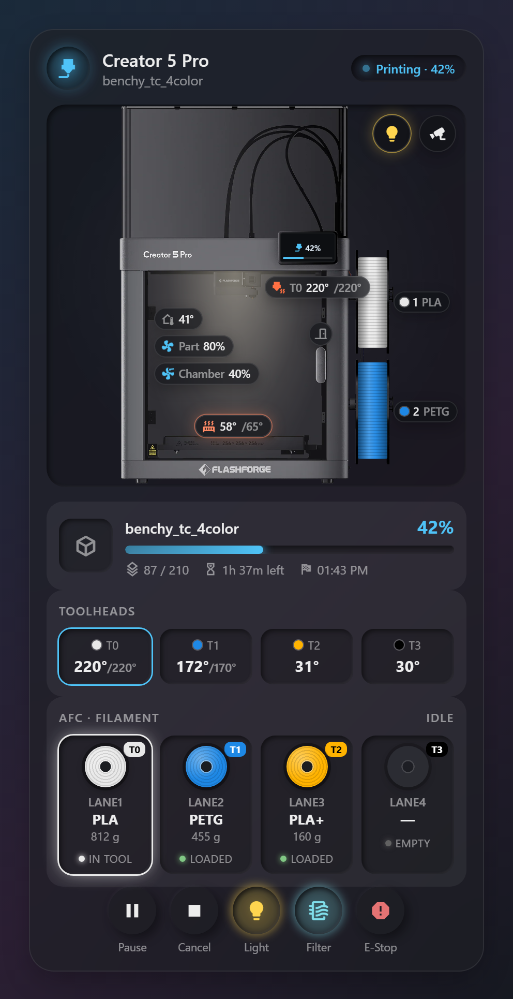
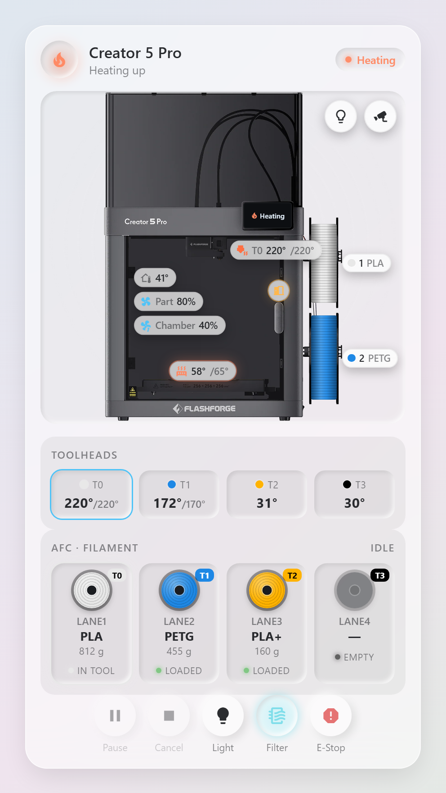

# Prism Flashforge Card – Creator 5 Pro

A Home Assistant Lovelace card in the **Prism** style (dark/light glass, inset wells, glowing accents) for the **Flashforge Creator 5 Pro**.

| Printing (dark theme) | Heating, door open (light theme) |
|---|---|
|  |  |

<sub>Screenshots use demo data.</sub>

Live sensor values sit on top of the printer image:

| Where on the image | What it shows |
|---|---|
| Touch screen | Status icon, progress %, mini progress bar |
| Next to the toolhead | Active tool nozzle temp / target (glows while heating) |
| Build plate | Bed temp / target |
| Inside the enclosure (left) | Chamber temp, part / aux / chamber fan % (icons spin with speed) |
| Door handle | Door open/closed (amber when open) |
| Chamber | Warm glow when the chamber light is on |
| Side spools | Repainted in the AFC lane colors, with lane number and material |

Below the image: print job (thumbnail, filename, progress bar, layer, time left, ETA), toolhead temps (T0–T3, each with its AFC lane color), AFC lanes (color reel, material, weight, status, active lane glow) and buttons (pause/resume, cancel, light, filtration, E-stop). Top-right buttons on the image toggle the light and switch to the live camera.

## Install

### HACS (recommended)

1. In Home Assistant, open **HACS**.
2. Click **⋮ → Custom repositories**.
3. Repository: `https://github.com/rickkollins/FF-Creator-5-HA-Card`, Type: **Dashboard**, then **Add**.
4. Search HACS for **Prism Flashforge Card**, open it and click **Download**.
5. HACS adds the dashboard resource for you (`/hacsfiles/FF-Creator-5-HA-Card/prism-flashforge-card.js`). If it doesn't, add it by hand as in step 2 of the manual install, using that URL.
6. Hard-refresh the browser (Ctrl+F5), then add the card **Prism Flashforge Creator 5 Pro** from the card picker.

HACS installs everything in `dist/`, including the printer image. Updates appear in HACS whenever this repository changes.

### Manual

1. Copy `dist/prism-flashforge-card.js` **and** `dist/creator5pro.webp` into `/config/www/prism-flashforge/`. Keep them in the same folder: the card finds the image next to the script.
2. **Settings → Dashboards → ⋮ → Resources → Add resource**
   - URL: `/local/prism-flashforge/prism-flashforge-card.js`
   - Type: **JavaScript module**
3. Hard-refresh the browser, then add the card **Prism Flashforge Creator 5 Pro** from the card picker.

## Choosing the Moonraker instance

In the visual editor, **Moonraker printer** lists every device from the [Moonraker integration](https://github.com/marcolivierarsenault/moonraker-home-assistant). Pick the one that is your Creator 5 Pro. The card then finds that device's entities on its own. Add a second card with another device for a second printer.

You can also do it in YAML:

```yaml
type: custom:prism-flashforge-card
name: Creator 5 Pro
printer: 3f1c2d...            # Moonraker device id (the editor fills this in)
# or, without a device:
# prefix: creator_5_pro       # matches sensor.creator_5_pro_*
flashforge_device: 9ab7...    # optional: device from the Flashforge integration/add-on
theme: dark                   # dark | light
accent_color: "#4fc3f7"
show_job: true
show_tools: true
show_afc: true
tint_spools: true
spool_lanes: [0, 1]           # which AFC lanes paint the top/bottom spool on the image
show_fans: true
show_camera: true
show_controls: true
```

If you leave `printer` empty, the card uses the first Moonraker device it finds.

## Flashforge add-on

The Flashforge device (`flashforge_device`) is searched first for: chamber temperature, chamber light, door sensor, filtration, chamber fan and camera. Everything else comes from Moonraker first. Leave it empty and the card looks for any device whose integration name contains `flashforge`.

## AFC filament colors

The card reads AFC lanes in one of three ways, in this order:

### 1. One REST sensor with Moonraker's AFC objects (recommended)

The Moonraker integration does not expose AFC lane colors, so add this to `configuration.yaml`. Change the IP address and the lane list to match your setup (newer AFC versions use `AFC_lane laneN`, older ones use `AFC_stepper laneN`; the card reads both).

```yaml
rest:
  - resource: "http://192.168.1.50:7125/printer/objects/query?AFC&AFC_lane%20lane1&AFC_lane%20lane2&AFC_lane%20lane3&AFC_lane%20lane4"
    scan_interval: 10
    sensor:
      - name: "Creator 5 Pro AFC"
        unique_id: creator_5_pro_afc
        value_template: "{{ value_json.result.status.AFC.current_load | default('none', true) }}"
        json_attributes_path: "$.result.status"
        json_attributes:
          - AFC
          - AFC_lane lane1
          - AFC_lane lane2
          - AFC_lane lane3
          - AFC_lane lane4
```

Then set it in the card (editor: **AFC → AFC data entity**):

```yaml
afc:
  entity: sensor.creator_5_pro_afc
```

The card uses each lane's `color`, `material`, `weight`, `map` (T0…), `extruder`, `tool_loaded`, `load`/`prep` and `status`, plus `AFC.current_load` / `AFC.current_state`.

### 2. Lanes listed in YAML

Each value can be a fixed value or an entity id:

```yaml
afc:
  current_lane: sensor.creator_5_pro_afc_current_lane
  lanes:
    - name: lane1
      color: input_text.lane1_color     # or "#e07b39"
      material: PLA
      weight: sensor.lane1_weight
      tool: T0
    - name: lane2
      color: "#6b6fd6"
      material: PETG
      tool: T1
```

### 3. Found automatically

Entities named like `sensor.<anything>_lane1_color`, `_lane1_material`, `_lane1_weight`, `_lane1_status` on the chosen devices (or any entity id containing `afc` and `lane`) are grouped into lanes.

## Entity overrides

If something isn't found or the wrong entity is picked, set it under **Entity overrides** in the editor or in YAML:

```yaml
entities:
  chamber_temp: sensor.creator_5_pro_chamber_temperature
  light: light.creator_5_pro_led
  door: binary_sensor.creator_5_pro_door
  camera: camera.creator_5_pro_webcam
```

Keys: `print_state`, `printer_state`, `progress`, `filename`, `time_left`, `eta`, `current_layer`, `total_layer`, `nozzle_temp`, `nozzle_target`, `bed_temp`, `bed_target`, `chamber_temp`, `part_fan`, `aux_fan`, `chamber_fan`, `light`, `door`, `filtration`, `camera`, `thumbnail`, `pause_button`, `resume_button`, `cancel_button`, `estop_button`, `active_tool`.

## Tool changer

The card finds every `sensor.*_extruderN_temperature` on the Moonraker device. With more than one, it shows a Toolheads row, and the overlay at the toolhead shows the active tool. The active tool comes from a `*_toolhead_extruder` / `*_active_extruder` sensor, or from the AFC lane that is loaded.

## Taps

Tap any overlay, tool, lane or the thumbnail to open its more-info dialog. Cancel and E-Stop ask for confirmation first.
